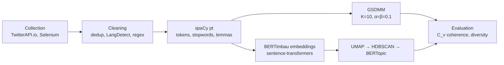

# How Brazil talks about superbugs

**Topic modeling of 70,103 Brazilian Portuguese texts on antimicrobial resistance, from Twitter/X, G1 news and gov.br.**

[](https://aclanthology.org/2026.propor-1.10/)


[Versão em português](README.pt-BR.md)

This repository holds the code behind the paper **"Topic Modeling in Brazilian Portuguese Documents on Antimicrobial Resistance"**, by Enrique Reis Susin and Lilian Berton (UNIFESP), published in the *Proceedings of the 17th International Conference on Computational Processing of Portuguese (PROPOR 2026)*, Vol. 1, pp. 103–110.

Antimicrobial resistance is one of the WHO's top global health threats, and much of antibiotic misuse starts in everyday conversation. This project uses NLP to compare how three parts of Brazilian society talk about it: the public (Twitter/X), the press (G1) and the government (gov.br).

## Results

Two short-text topic models were compared on the same corpus. BERTopic, using embeddings from the Brazilian Portuguese model BERTimbau, beat the probabilistic baseline GSDMM on both intrinsic metrics:

| Model | Coherence (C<sub>v</sub>) | Diversity |
| --- | ---: | ---: |
| GSDMM | 0.4471 | 0.7467 |
| **BERTopic + BERTimbau** | **0.5032** (+12.5%) | **0.9278** (+24.3%) |

Absolute coherence is low for both models, as expected for short and noisy texts. The gain is in the comparison: BERTopic separated informative clusters from noise better, and its topics overlapped less.

What the topics revealed:

- **The public mixes up pathogens.** One topic puts *virus*, *bacteria*, *vaccine* and *antibiotic* side by side. That signals confusion about what antibiotics treat.
- **People ignore symptoms and self-medicate.** Another topic joins *infection*, *medication* and the verb *ignore*.
- **Each source plays a different part.** Twitter carries personal experience and misinformation, G1 translates science for the public, and gov.br speaks with normative authority.
- **Two themes appear in every source:** antimicrobial resistance and HIV coinfection. They are natural starting points for automated health surveillance.

## Data

| Source | Documents | Register |
| --- | ---: | --- |
| Twitter/X (2008–2025, via TwitterAPI.io) | 64,225 | Informal |
| G1 news, science and health sections | 4,363 | Journalistic |
| gov.br official publications | 1,515 | Institutional |
| **Total** | **70,103** | |

The same keywords were searched in every source: antibiotic, bacteria, tuberculosis, urinary tract infection, sepsis, pneumonia, amoxicillin and resistance variants.

## Pipeline



1. **Collection.** Tweets come through TwitterAPI.io. G1 and gov.br pages are scraped with Selenium and BeautifulSoup.
2. **Cleaning.** Duplicates are removed. LangDetect keeps only Portuguese, since words like *resistencia* also occur in Spanish. Mentions, links, hashtags, emoji and laughter (*kkkkk*, *rsrsrs*) are stripped, and texts with fewer than 6 tokens are dropped.
3. **Normalization.** spaCy `pt_core_news_sm` tokenizes the text, removes stopwords and lemmatizes it.
4. **Modeling.**
   - *GSDMM* uses K=10, α=0.1, β=0.1 and 30 iterations.
   - *BERTopic* uses BERTimbau Base, UMAP with 10 neighbors and 5 components, and HDBSCAN with min_cluster_size=7, min_samples=5 and EOM selection. Representations come from MMR with diversity 0.1. Noisy topics were removed and the clusters refined over several rounds (seven for tuberculosis).
5. **Evaluation.** Topic coherence (C<sub>v</sub>, gensim) and topic diversity (share of unique words among each topic's top-N).

## Repository layout

```
WebScraping/        G1 and gov.br scrapers (Selenium + BeautifulSoup)
Noise_remover/      cleaning, language detection, tokenization, lemmatization
Topic_Modeler/
  topics.ipynb      GSDMM baseline and its metrics
  topic_bert.ipynb  BERTimbau + UMAP + HDBSCAN + BERTopic, and its metrics
dados/              raw and processed data per source and keyword
modelos_treinados/  saved GSDMM model
```

## Running it

```bash
python -m venv .venv && source .venv/bin/activate   # Windows: .venv\Scripts\activate
pip install -r requirements.txt
python -m spacy download pt_core_news_sm
jupyter lab
```

Run the notebooks in order: `Noise_remover` → `Topic_Modeler/topics.ipynb` (GSDMM) → `Topic_Modeler/topic_bert.ipynb` (BERTopic). The notebooks still point to absolute Windows paths from the original machine, so set `caminho_base` / `caminho_arquivo` at the top of each notebook to your local `dados/` folder.

## Ethics

The study follows the paper's commitment: tweets are analyzed only in aggregate, for academic purposes, and no information that identifies users is reported.

## Citation

```bibtex
@inproceedings{susin-berton-2026-topic,
  title     = {Topic Modeling in Brazilian Portuguese Documents on Antimicrobial Resistance},
  author    = {Susin, Enrique Reis and Berton, Lilian},
  booktitle = {Proceedings of the 17th International Conference on Computational Processing of Portuguese (PROPOR 2026)},
  volume    = {1},
  pages     = {103--110},
  year      = {2026},
  publisher = {Association for Computational Linguistics}
}
```

## Authors

- **Enrique Reis Susin**, Institute of Science and Technology, UNIFESP: collection, pipeline, modeling and evaluation.
- **Prof. Lilian Berton**, Institute of Science and Technology, UNIFESP: advisor.

Funded by Conselho Nacional de Desenvolvimento Científico e Tecnológico (CNPq).
