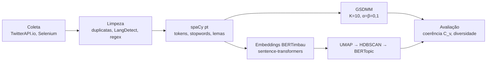

# Como o Brasil fala de superbactérias

**Modelagem de tópicos em 70.103 textos em português sobre resistência antimicrobiana, vindos do Twitter/X, do G1 e do gov.br.**

[](https://aclanthology.org/2026.propor-1.10/)


**[Veja a página interativa do projeto →](https://amr-topic-modeling-site-umber.vercel.app/pt/)** · [English version](README.md)

Este repositório guarda o código do artigo **"Topic Modeling in Brazilian Portuguese Documents on Antimicrobial Resistance"**, de Enrique Reis Susin e Lilian Berton (UNIFESP), publicado nos *Proceedings of the 17th International Conference on Computational Processing of Portuguese (PROPOR 2026)*, vol. 1, pp. 103–110.

A resistência antimicrobiana é uma das maiores ameaças à saúde global segundo a OMS, e boa parte do mau uso de antibióticos começa numa conversa. O projeto usa PLN para comparar como três setores da sociedade brasileira falam do tema: o público (Twitter/X), a imprensa (G1) e o governo (gov.br).

## Resultados

Dois modelos de tópicos para textos curtos foram comparados no mesmo corpus. O BERTopic, com embeddings do BERTimbau (modelo treinado em português brasileiro), superou o GSDMM, a referência probabilística, nas duas métricas:

| Modelo | Coerência (C<sub>v</sub>) | Diversidade |
| --- | ---: | ---: |
| GSDMM | 0,4471 | 0,7467 |
| **BERTopic + BERTimbau** | **0,5032** (+12,5%) | **0,9278** (+24,3%) |

A coerência absoluta é baixa nos dois modelos, como se espera em textos curtos e ruidosos. O ganho está na comparação: o BERTopic separou melhor o que era informação do que era ruído, e seus tópicos repetiram menos palavras.

O que os tópicos revelaram:

- **O público confunde patógenos.** Um tópico junta *vírus*, *bactéria*, *vacina* e *antibiótico*, sinal de confusão sobre o que o antibiótico trata.
- **Sintomas ignorados e automedicação.** Outro tópico une *infecção*, *medicação* e o verbo *ignorar*.
- **Cada fonte tem um papel.** O Twitter traz experiência pessoal e desinformação, o G1 traduz a ciência para o público e o gov.br fala como autoridade normativa.
- **Dois temas aparecem em todas as fontes:** resistência antimicrobiana e coinfecção por HIV. São pontos de partida para vigilância automatizada em saúde.

## Dados

| Fonte | Documentos | Registro |
| --- | ---: | --- |
| Twitter/X (2008–2025, via TwitterAPI.io) | 64.225 | Informal |
| G1, seções de ciência e saúde | 4.363 | Jornalístico |
| gov.br, publicações oficiais | 1.515 | Institucional |
| **Total** | **70.103** | |

As mesmas palavras-chave foram buscadas em todas as fontes: antibiótico, bactéria, tuberculose, infecção urinária, sepse, pneumonia, amoxicilina e variações de resistência.

## Pipeline



1. **Coleta.** Os tweets vêm pela TwitterAPI.io. O G1 e o gov.br são raspados com Selenium e BeautifulSoup.
2. **Limpeza.** Duplicatas são removidas. O LangDetect mantém só o português, já que palavras como *resistencia* também existem em espanhol. Saem menções, links, hashtags, emojis e risadas (*kkkkk*, *rsrsrs*), e textos com menos de 6 tokens são descartados.
3. **Normalização.** O spaCy `pt_core_news_sm` tokeniza, remove stopwords e lematiza.
4. **Modelagem.**
   - *GSDMM* usa K=10, α=0,1, β=0,1 e 30 iterações.
   - *BERTopic* usa o BERTimbau Base, UMAP com 10 vizinhos e 5 componentes, e HDBSCAN com min_cluster_size=7, min_samples=5 e seleção EOM. As representações vêm do MMR com diversidade 0,1. Os tópicos de ruído foram removidos e os clusters refinados em várias rodadas (sete para tuberculose).
5. **Avaliação.** Coerência de tópicos (C<sub>v</sub>, gensim) e diversidade de tópicos (proporção de palavras únicas entre as top-N de cada tópico).

## Estrutura

```
WebScraping/        raspadores do G1 e do gov.br (Selenium + BeautifulSoup)
Noise_remover/      limpeza, detecção de idioma, tokenização e lematização
Topic_Modeler/
  topics.ipynb      GSDMM e suas métricas
  topic_bert.ipynb  BERTimbau + UMAP + HDBSCAN + BERTopic e suas métricas
dados/              dados brutos e processados por fonte e palavra-chave
modelos_treinados/  modelo GSDMM salvo
```

## Como rodar

```bash
python -m venv .venv && source .venv/bin/activate   # Windows: .venv\Scripts\activate
pip install -r requirements.txt
python -m spacy download pt_core_news_sm
jupyter lab
```

Rode os notebooks nesta ordem: `Noise_remover` → `Topic_Modeler/topics.ipynb` (GSDMM) → `Topic_Modeler/topic_bert.ipynb` (BERTopic). Os notebooks ainda usam caminhos absolutos do Windows da máquina original, então ajuste `caminho_base` / `caminho_arquivo` no início de cada um para a sua pasta `dados/`.

## Ética

O estudo segue o compromisso do artigo: os tweets são analisados apenas de forma agregada, para fins acadêmicos, e nenhuma informação que identifique usuários é divulgada.

## Como citar

```bibtex
@inproceedings{susin-berton-2026-topic,
  title     = {Topic Modeling in Brazilian Portuguese Documents on Antimicrobial Resistance},
  author    = {Susin, Enrique Reis and Berton, Lilian},
  booktitle = {Proceedings of the 17th International Conference on Computational Processing of Portuguese (PROPOR 2026)},
  volume    = {1},
  pages     = {103--110},
  year      = {2026},
  publisher = {Association for Computational Linguistics}
}
```

## Autores

- **Enrique Reis Susin**, Instituto de Ciência e Tecnologia, UNIFESP: coleta, pipeline, modelagem e avaliação.
- **Profa. Lilian Berton**, Instituto de Ciência e Tecnologia, UNIFESP: orientação.

Apoio do Conselho Nacional de Desenvolvimento Científico e Tecnológico (CNPq).
